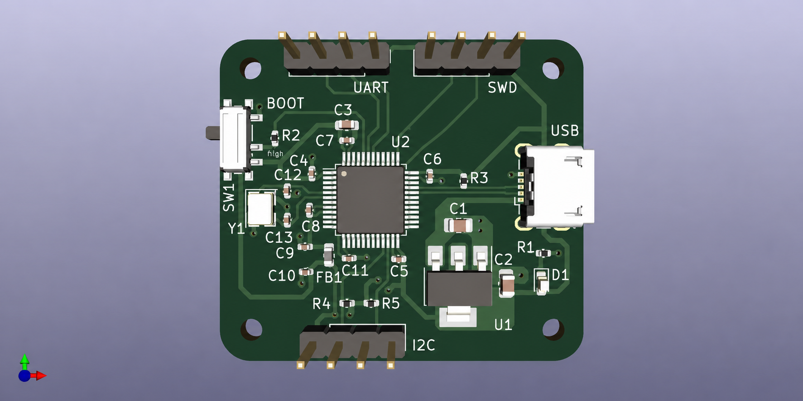
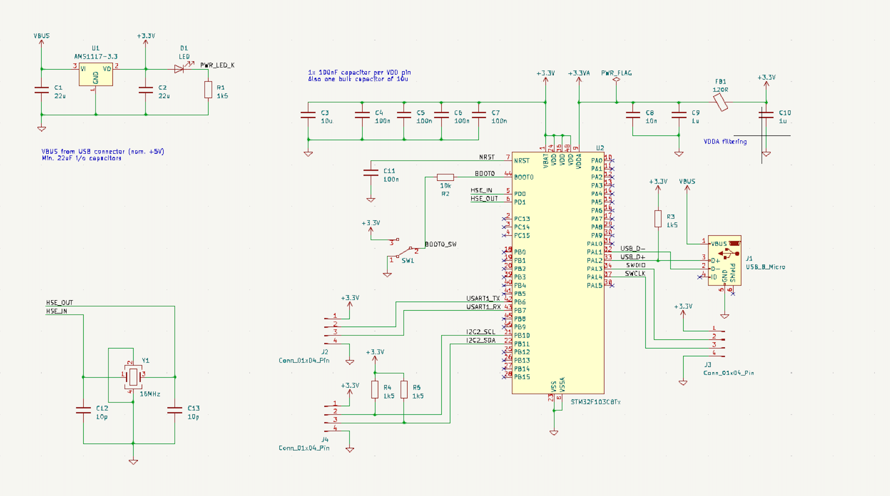
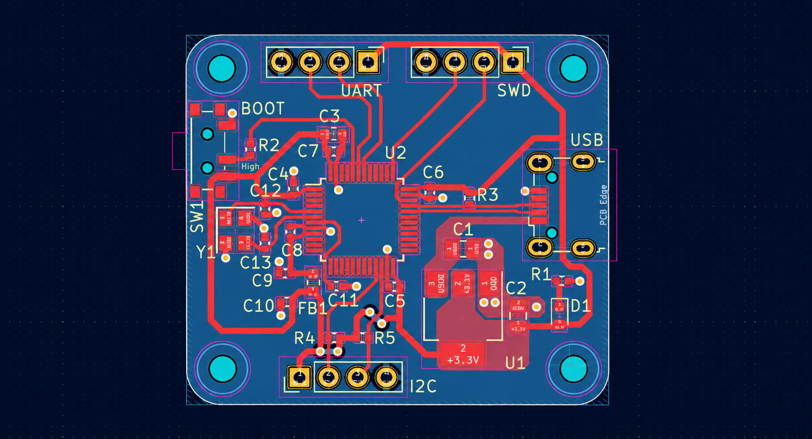

# STM32F103 Development Board


A compact hardware development board project designed around the **STMicroelectronics STM32F103C8T6** (ARM Cortex-M3) microcontroller in **KiCad 7**.

---

## 📸 Visual Gallery

### 1. 3D Board Rendering


### 2. Schematic Diagram


### 3. PCB Layout & Routing


---

## ⚡ Key Hardware Features

- **Microcontroller Core**:
  - STM32F103C8T6 (LQFP-48)
  - 32-bit ARM Cortex-M3 RISC core operating at up to 72 MHz
  - 64 KB Flash memory and 20 KB SRAM
- **Power Management**:
  - Micro-USB 5V input with input decoupling
  - Onboard AMS1117-3.3 linear voltage regulator delivering clean +3.3V rail
  - Decoupling capacitors (100nF per VDD/VDDA pin + 10µF/22µF filter caps)
  - Power indicator LED (`PWR_LED`) with current-limiting resistor
  - Ferrite bead (`FB1`) isolation for analog supply (`VDDA`)
- **Clock Subsystem**:
  - 16 MHz High-Speed External (HSE) crystal oscillator (`Y1`) with 10pF load capacitors
- **Boot Configuration**:
  - Slide switch (`SW1`) with 10k pull-down resistor on `BOOT0` pin for selecting Flash execution or System ROM / DFU bootloader mode
- **Communication & Debug Headers**:
  - **SWD Header**: 4-pin male pin header (VCC, SWDIO, SWCLK, GND) for in-circuit programming and debugging via ST-Link V2 / J-Link
  - **UART Header**: Dedicated header for `USART1` (PA9/TX, PA10/RX) serial console telemetry
  - **I2C Header**: 4-pin breakout for `I2C2` (PB10/SCL, PB11/SDA) with onboard 1.5kΩ pull-up resistors
  - **USB Interface**: Micro-USB port wired to MCU native USB pins (`USB_D-`, `USB_D+`) with a 1.5kΩ pull-up resistor on `USB_D+`
- **Mechanical & Enclosure Design**:
  - 4-corner mounting holes for mechanical enclosure integration
  - 2-layer compact PCB layout

---

## 📁 Repository Structure

```
stm32-devboard/
├── assets/
│   ├── 3dview_img.png            # 3D rendered view of assembled board
│   ├── pcb_img.png               # 2D routed PCB layout screenshot
│   └── sch_img.png               # Complete KiCad schematic screenshot
├── 629105150521 (rev1).stp        # 3D STEP CAD model for Micro-USB receptacle
├── stm32_board.kicad_sch         # KiCad schematic design file
├── stm32_board.kicad_pcb         # KiCad PCB layout design file
├── stm32_board.kicad_pro         # KiCad project file
├── stm32_board.kicad_prl         # KiCad project local settings
├── .gitignore                    # Git ignore file for KiCad temporary files
└── README.md                     # Project documentation
```

---

## 🚀 How to Open and Inspect

1. **Prerequisites**: Install [KiCad 7.0 or higher](https://www.kicad.org/download/).
2. **Clone the Repository**:
   ```bash
   git clone https://github.com/nikunjmalik306/stm32-devboard.git
   cd stm32-devboard
   ```
3. **Open Project**:
   - Launch KiCad.
   - Click **File > Open Project** and select `stm32_board.kicad_pro`.
   - Open the Schematic Editor or PCB Editor (`Alt + 3` / `Option + 3` for 3D Viewer).

---

## 🤝 Credits & Acknowledgments
- **Made by**: [Nikunj Malik](https://github.com/nikunjmalik306)
